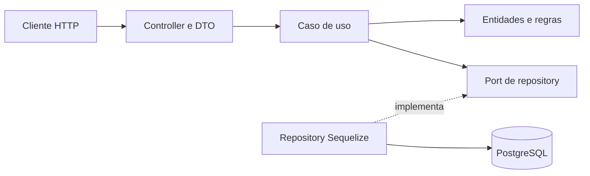

# CATALISA

Back-end da plataforma CATALISA, criada para apoiar a participação em desafios de eventos. A API permite cadastrar participantes, publicar soluções, comentar, responder, curtir conteúdos e executar moderação administrativa.

## Sumário

- [Sobre o projeto](#sobre-o-projeto)
- [Tecnologias utilizadas](#tecnologias-utilizadas)
- [Arquitetura e fluxo](#arquitetura-e-fluxo)
- [Instalação e execução](#instalação-e-execução)
- [Testes](#testes)
- [Contribuição](#contribuição)
- [Documentação](#documentação)
- [Licença](#licença)
- [Autor](#autor)

## Sobre o projeto

A CATALISA organiza a experiência de um evento em torno de desafios:

1. um participante cria seu cadastro e recebe um `userCode`;
2. consulta os desafios ativos;
3. publica uma solução para um desafio;
4. outros participantes comentam, respondem e curtem;
5. administradores controlam status e moderam conteúdo;
6. um `SUPER_ADMIN` pode promover participantes para `ADMIN` e executar remoções diretas auditadas.

O projeto é uma API HTTP modular. Nas operações de participação, o `userCode` identifica o usuário sem autenticar sua autoria. Operações administrativas usam JWT. O contrato de respostas é padronizado por `CatalisaCodes`.

### Funcionalidades

- cadastro e perfil público de participantes;
- catálogo de desafios ativos;
- publicação e consulta de soluções;
- comentários e respostas encadeadas;
- likes em soluções e comentários;
- autenticação administrativa e rotação de senha;
- alteração de status de usuários, desafios e conteúdos;
- moderação direta ou por aprovação em duas etapas.

## Tecnologias utilizadas

| Categoria | Tecnologia |
| --- | --- |
| Runtime | Node.js 26 no host e no Docker |
| Linguagem | TypeScript 6 |
| Framework | NestJS 11 sobre Express 5 |
| Persistência | Sequelize 6 |
| Banco de dados | PostgreSQL |
| Autenticação | JWT HS256 e bcrypt |
| Validação | class-validator e class-transformer |
| Documentação HTTP | Swagger/OpenAPI |
| Testes | Jest, Supertest e PostgreSQL em Docker |
| Infraestrutura local | Docker e Docker Compose |

## Arquitetura e fluxo

A aplicação é um monólito modular. Cada feature separa entrada HTTP, aplicação, domínio e infraestrutura:

```text
HTTP request
  -> Controller + DTO
  -> Use case
  -> Port de repository
  -> Repository Sequelize + mapper
  -> PostgreSQL
  -> Presenter / envelope HTTP
```



Módulos registrados em `AppModule`:

| Módulo | Responsabilidade |
| --- | --- |
| Database | conexão Sequelize e associações |
| Users | cadastro, perfil e status |
| Authentication | login, JWT, senha e promoção |
| Challenges | consulta e status dos desafios |
| Solutions | publicação, consulta e moderação |
| Comments | comentários, respostas e status |
| Likes | criação, remoção e contagem |
| Moderation | solicitações e revisões de remoção |

Consulte os [designs por módulo](docs/designs/README.md) e os [flows de negócio](docs/flows/README.md) para os diagramas completos.

## Instalação e execução

### Pré-requisitos

- Node.js na versão indicada em [`.nvmrc`](.nvmrc);
- npm;
- Docker Desktop com engine Linux e Docker Compose v2;
- PostgreSQL local apenas se a API for executada fora do Docker.

### Executando localmente com Docker

```powershell
npm ci
Copy-Item .env.example .env
```

Preencha `DB_PASSWORD` e `JWT_SECRET` no `.env`. Para criar o primeiro `SUPER_ADMIN`, preencha também `INITIAL_SUPER_ADMIN_*`, incluindo uma senha inicial própria. O `JWT_SECRET` deve ter pelo menos 32 bytes.

```powershell
docker compose up --build -d
docker compose --profile bootstrap run --rm bootstrap-admin
docker compose run --rm migrate npm run db:seed:challenges
docker compose ps
```

Execute o seed de desafios uma vez em um banco local novo. Após a carga, `GET /challenges` retorna os desafios ativos.

A API estará disponível em `http://localhost:3000` e o Swagger em `http://localhost:3000/docs`.
O comportamento completo do bootstrap está em [scripts/README.md](scripts/README.md).

### Executando a API no host

Configure um PostgreSQL local no `.env` e execute:

```powershell
npm ci
npm run db:migrate
npm run db:seed:challenges
npm run admin:bootstrap
npm run start:dev
```

O guia completo, incluindo variáveis e troubleshooting, está em [docs/guides/local-setup.md](docs/guides/local-setup.md).

## Testes

```powershell
npm test                          # testes unitários
npm run test:cov                  # cobertura
npm run test:integration:docker   # integração com PostgreSQL isolado
npm run test:integration:docker:down
```

Gates recomendados antes de abrir um pull request:

```powershell
npm run typecheck
npm run lint
npm run format:check
npm test
npm run test:integration:docker
```

Veja o [tutorial de testes](docs/guides/testing.md) para preparação, execução seletiva, cobertura, integração e diagnóstico.

## Contribuição

1. Crie uma branch a partir da base atual.
2. Preserve a separação entre controller, use case, domínio e infraestrutura.
3. Crie migration para qualquer alteração de schema; não use `sequelize.sync()`.
4. Atualize testes, designs, flows e collection quando o contrato mudar.
5. Registre decisões permanentes em ADR e propostas ainda não implementadas em RFC.
6. Execute os gates de qualidade antes do pull request.

Mais detalhes em [docs/guides/contributing.md](docs/guides/contributing.md).

## Documentação

| Conteúdo | Local |
| --- | --- |
| Contexto e índice | [docs/README.md](docs/README.md) |
| Estrutura e endpoints por módulo | [docs/designs/](docs/designs/README.md) |
| Fluxos dos principais casos de uso | [docs/flows/](docs/flows/README.md) |
| Decisões aceitas | [docs/adr/](docs/adr/README.md) |
| Propostas em discussão | [docs/rfc/](docs/rfc/README.md) |
| Collection Postman | [docs/collections/](docs/collections/README.md) |
| Procedimentos | [docs/guides/](docs/guides/README.md) |

## Licença

ISC, conforme os metadados do pacote.

## Autor

Github - @thaissacarvalho
Linkedin: https://www.linkedin.com/in/thaissacarvalhodev/
