# Arquitetura da CATALISA

Este documento descreve a arquitetura implementada no back-end da CATALISA. Ele foi derivado de `src/`, das migrations, dos testes e dos arquivos de infraestrutura. Propostas futuras devem ser registradas em [RFCs](../rfc/README.md); decisões aceitas ficam em [ADRs](../adr/README.md).

## Sumário

- [Contexto do sistema](#contexto-do-sistema)
- [Visão de containers](#visão-de-containers)
- [Estilo arquitetural](#estilo-arquitetural)
- [Estrutura do código](#estrutura-do-código)
- [Módulos e dependências](#módulos-e-dependências)
- [Ciclo de uma requisição](#ciclo-de-uma-requisição)
- [Autenticação e autorização](#autenticação-e-autorização)
- [Domínio e regras centrais](#domínio-e-regras-centrais)
- [Persistência e transações](#persistência-e-transações)
- [Contrato HTTP](#contrato-http)
- [Configuração e bootstrap](#configuração-e-bootstrap)
- [Execução com containers](#execução-com-containers)
- [Estratégia de testes](#estratégia-de-testes)
- [Segurança](#segurança)
- [Limitações conhecidas](#limitações-conhecidas)
- [Regras para evolução](#regras-para-evolução)

## Contexto do sistema

A CATALISA apoia participação em desafios de eventos. O sistema atende dois grupos principais:

- participantes, que consultam desafios, publicam soluções, comentam e curtem;
- administradores, que controlam status, promovem outros administradores e moderam conteúdo.

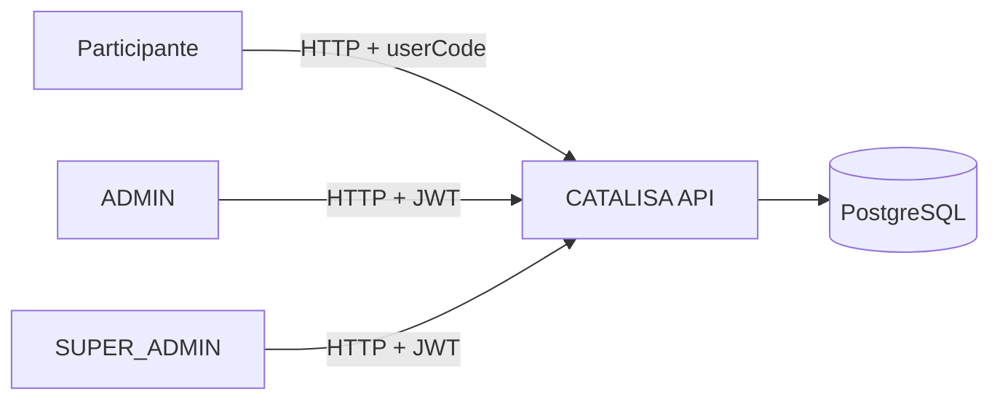

### Fronteiras externas

| Ator/dependência | Interação |
| --- | --- |
| Cliente web/mobile | consome JSON por HTTP |
| Administrador | usa Bearer JWT em rotas protegidas |
| PostgreSQL | armazena estado transacional e auditoria |
| Docker Compose | orquestra banco, migrations, API e bootstrap |
| Swagger UI | expõe documentação interativa em `/docs` |

Não existem integrações externas de mensageria, cache, storage ou identidade no código atual.

## Visão de containers

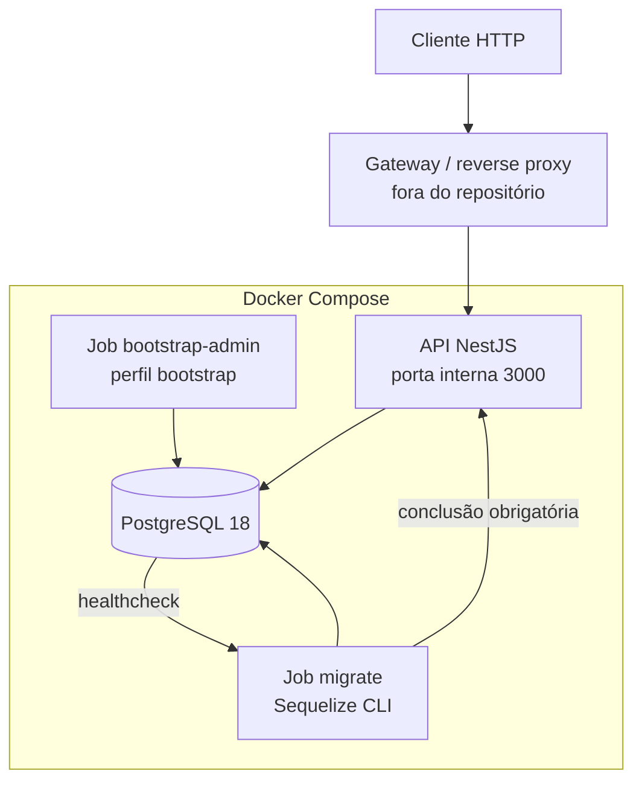

No desenvolvimento, o proxy é opcional e o cliente acessa a porta publicada da API diretamente. O PostgreSQL do Compose não publica porta no host.

## Estilo arquitetural

A aplicação é um monólito modular NestJS com separação inspirada em Clean Architecture. Todos os módulos são compilados, executados e publicados como uma única unidade.

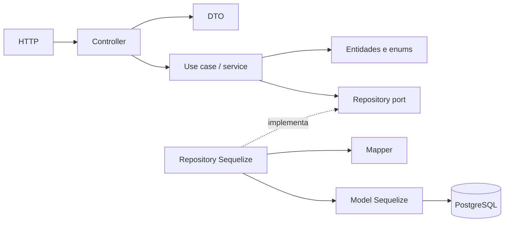

### Regra de dependência

```text
HTTP/NestJS -> application -> domain
infrastructure -> domain
domain -> TypeScript puro
```

O domínio não importa NestJS, HTTP ou Sequelize. Casos de uso conhecem ports, não adapters concretos. Controllers não consultam models diretamente.

### Responsabilidades por camada

| Camada | Responsabilidade | Exemplos |
| --- | --- | --- |
| Entrada HTTP | rota, status, DTO e identidade da requisição | controllers, decorators e pipes |
| Application | orquestração e autorização do caso de uso | `CreateSolutionUseCase` |
| Domain | estado e contratos independentes de framework | entities, enums e repository ports |
| Infrastructure | persistência, queries, transações e mapeamento | repositories e models Sequelize |
| Common | contratos transversais | guards, `CatalisaCodes`, filtros e helpers |

A decisão está registrada no [ADR 0002](../adr/0002-modular-layered-architecture.md).

## Estrutura do código

```text
src/
├── app.module.ts
├── main.ts
├── config/
├── database/
├── common/
│   ├── authentication/
│   ├── authorization/
│   ├── domain/
│   └── http/
├── users/
├── challenges/
├── solutions/
├── comments/
├── likes/
└── moderation/
```

Estrutura esperada em uma feature:

```text
feature/
├── feature.module.ts
├── application/
│   ├── controllers/
│   ├── dto/
│   ├── use-cases/
│   ├── presenters/
│   └── helpers/
├── domain/
│   ├── entities/
│   ├── enums/
│   └── repositories/
└── infrastructure/
    └── persistence/sequelize/
        ├── models/
        ├── mappers/
        └── repositories/
```

Nem todas as features precisam de todas as pastas. Presenters existem onde o contrato público difere da entidade.

## Módulos e dependências

`AppModule` é o composition root. Ele importa oito módulos e não contém regra de negócio.

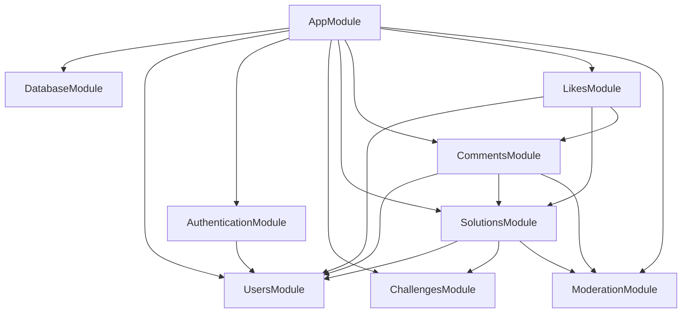

| Módulo | Responsabilidade | Importa | Exporta |
| --- | --- | --- | --- |
| Database | conexão e ciclo de vida do Sequelize | — | `DATABASE_CONNECTION` |
| Users | cadastro, perfil público e status | — | `UserRepository`, `UpdateUserStatusUseCase` |
| Authentication | login, JWT, senha e promoção | Users | guards, JWT, service e credential repository |
| Challenges | consulta e status de desafios | — | `ChallengeRepository` |
| Solutions | publicação, consulta e status | Users, Challenges, Moderation | `SolutionRepository` |
| Comments | comentários, respostas e status | Solutions, Users, Moderation | repository e casos de uso selecionados |
| Likes | criação, remoção e contagem | Users, Solutions, Comments | — |
| Moderation | solicitação, revisão e remoção direta | — | `DirectRemovalUseCase` |

`DatabaseModule` e `AuthenticationModule` são globais. O mapa detalhado está em [dependencies.md](./dependencies.md), e cada módulo possui um documento em [`modules/`](./modules/).

## Ciclo de uma requisição

### Requisição pública

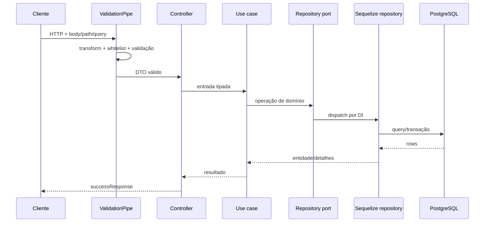

### Requisição administrativa

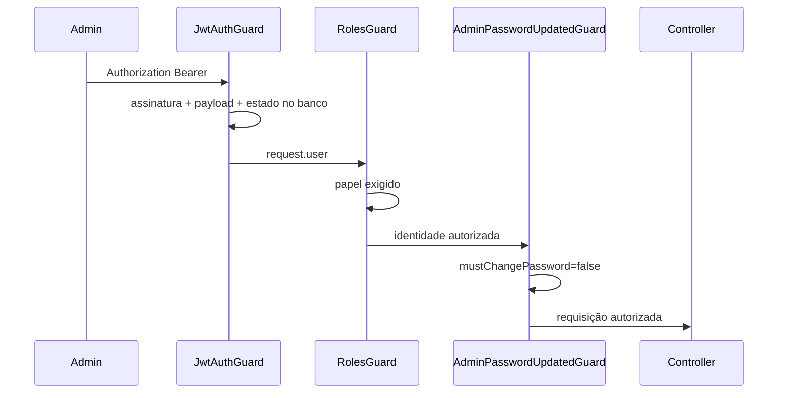

Nem toda rota protegida usa os três guards. `GET /authentication/me` exige apenas JWT; troca de senha exige JWT e papel; rotas administrativas comuns também exigem senha inicial atualizada.

## Autenticação e autorização

### Modelo administrativo

Credenciais administrativas ficam separadas do perfil em `admin_credentials`. Senhas usam bcrypt com custo 12 e nunca são persistidas em texto.

O JWT usa HS256 e contém:

| Claim | Uso |
| --- | --- |
| `sub` | UUID interno do usuário |
| `userCode` | identidade pública |
| `role` | `ADMIN` ou `SUPER_ADMIN` |
| `mustChangePassword` | bloqueio de operações antes da troca inicial |
| `credentialVersion` | ISO de `passwordChangedAt` ou `null` |
| `type` | deve ser `ACCESS` |
| `iat` / `exp` | emissão e expiração |

`JwtAuthGuard` valida assinatura, issuer, audience, algoritmo e expiração. Depois busca usuário e credencial no banco, comparando status, papel, `userCode`, flag de senha e versão da credencial. Assim, troca de senha, bloqueio ou mudança de papel invalidam o token imediatamente.

A decisão está no [ADR 0004](../adr/0004-admin-jwt-authentication.md).

### Papéis

| Papel | Capacidades implementadas |
| --- | --- |
| PARTICIPANT | publicar solução e criar/remover like quando ativo |
| ADMIN | operações administrativas e solicitações de remoção |
| SUPER_ADMIN | capacidades administrativas, promoção e remoção direta |

Algumas operações públicas, como comentários, validam apenas existência e status ativo, sem restringir o papel.

### Identidade do participante

Participantes não possuem credencial. Endpoints de escrita recebem `userCode` no payload ou query. O sistema confirma que o usuário existe, está ativo e possui papel aceito, mas não prova que o chamador controla aquela identidade.

Essa limitação está registrada como proposta na [RFC 0001](../rfc/0001-participant-authentication.md).

## Domínio e regras centrais

### Users

- `UserStatus`: `ACTIVE`, `INACTIVE`, `BLOCKED`, `SUSPENDED`.
- `UserRole`: `PARTICIPANT`, `ADMIN`, `SUPER_ADMIN`.
- E-mail e `userCode` são únicos.
- Existe no máximo um `SUPER_ADMIN`, garantido por índice parcial.

### Challenges

- `ChallengeStatus`: `ACTIVE` ou `INACTIVE`.
- Consultas públicas retornam somente desafios ativos.
- `displayOrder` é positivo e único.

### Solutions

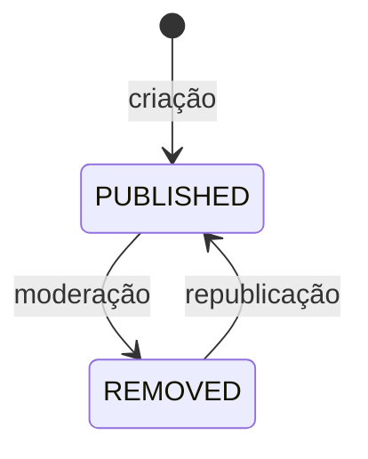

- Autor precisa estar ativo e ter papel `PARTICIPANT` ou `SUPER_ADMIN`.
- Para publicar, o desafio precisa existir e estar ativo.
- Consulta pública exige `PUBLISHED` e autor ativo. A listagem por desafio exige que ele exista, mesmo que esteja inativo.

### Comments

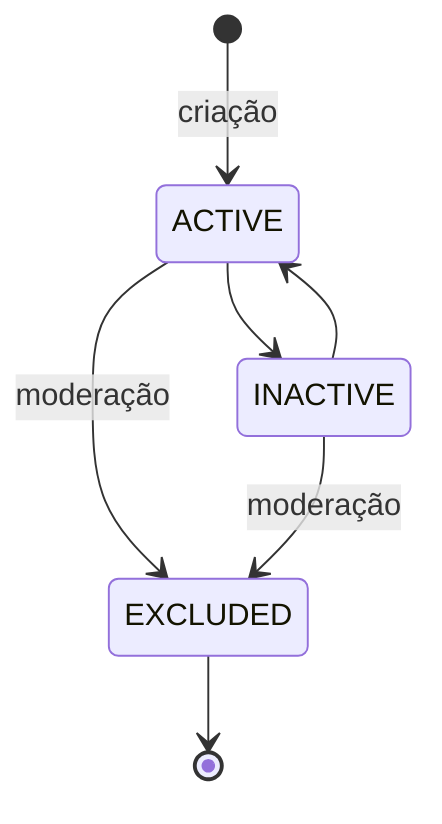

- Texto possui 50 a 280 caracteres após normalização.
- Solução precisa estar publicada.
- Resposta precisa referenciar um comentário visível da mesma solução. Um ancestral oculto também oculta as respostas.
- Autor precisa estar ativo.

### Likes

- Alvo é `SOLUTION` ou `COMMENT`.
- Exatamente uma FK de alvo deve estar preenchida.
- Um usuário pode curtir o mesmo alvo apenas uma vez.
- Criação e contagem exigem alvo visível.
- Remoção é idempotente e aceita alvo já oculto.

### Moderation

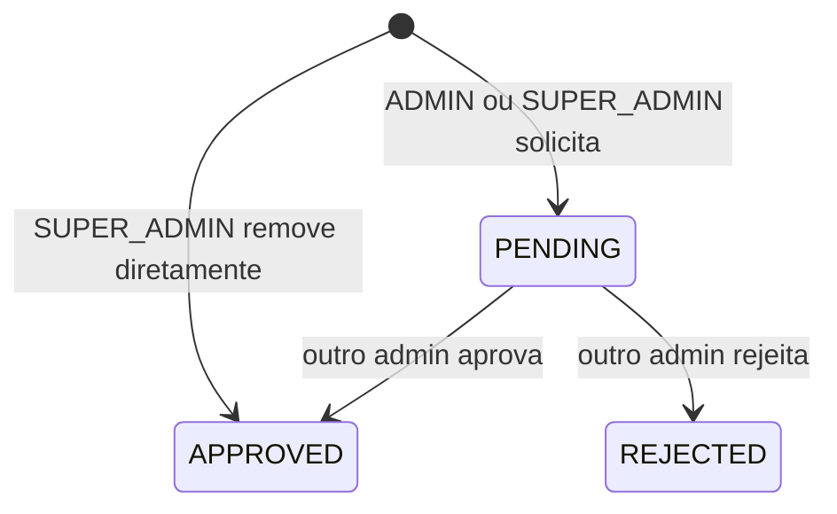

- Uma solicitação pendente por alvo.
- Solicitante não revisa o próprio pedido.
- Aprovação remove logicamente o alvo na mesma transação.
- Remoção direta cria auditoria aprovada.

A decisão está no [ADR 0005](../adr/0005-two-path-content-moderation.md).

## Persistência e transações

### Sequelize

`src/database/sequelize.ts` fornece uma instância compartilhada. `DatabaseModule`:

1. inicializa as associações;
2. executa `sequelize.authenticate()` em `onModuleInit`;
3. fecha a conexão em `onApplicationShutdown`.

`initializeModelAssociations()` é idempotente no processo e registra relacionamentos entre users, challenges, solutions, comments, likes e moderation requests.

### Schema

Migrations são a fonte autoritativa do schema. A API não chama `sequelize.sync()`. O job `migrate` executa antes da API no Compose, conforme [ADR 0003](../adr/0003-migrations-as-schema-source.md).

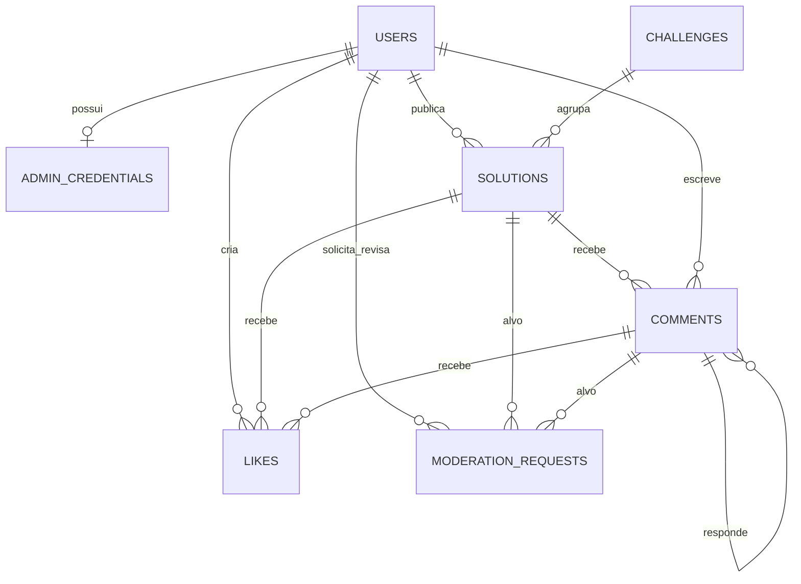

O detalhamento de tabelas, FKs, checks e índices está em [data-model.md](./data-model.md).

### Consistência

O banco reforça invariantes que não podem depender apenas da aplicação:

- unicidade de e-mail, `userCode`, challenge code e display order;
- um super-admin;
- um like por usuário/alvo;
- exatamente um alvo por like ou moderation request;
- uma solicitação pendente por alvo;
- coerência entre status da solicitação e campos de revisão;
- FKs com `CASCADE` ou `RESTRICT` de acordo com retenção de histórico.

Repositories de moderação usam transação para atualizar alvo e auditoria atomicamente.

## Contrato HTTP

### Validação

O `ValidationPipe` global usa:

| Opção | Efeito |
| --- | --- |
| `whitelist: true` | considera apenas propriedades declaradas |
| `forbidNonWhitelisted: true` | rejeita propriedades desconhecidas |
| `transform: true` | aplica transformações declaradas nos DTOs |
| `exceptionFactory` | converte qualquer falha em `INVALID_REQUEST` |

Não existe prefixo global ou versionamento de URI. As rotas partem diretamente de `/users`, `/solutions`, `/authentication` etc.

### Sucesso

```json
{
  "success": true,
  "type": "SUCCESS",
  "code": "MCODE-S001",
  "message": "User created",
  "statusCode": 201,
  "data": {}
}
```

`DELETE /likes` é a exceção: retorna `204` sem body.

### Erro

```json
{
  "success": false,
  "type": "ERROR",
  "code": "MCODE-019",
  "message": "Invalid request",
  "statusCode": 400
}
```

`AppHttpException` carrega um `CatalisaErrorCode`. O filtro global preserva erros conhecidos e converte exceções genéricas conforme o status HTTP. Falhas inesperadas retornam `INTERNAL_SERVER_ERROR` sem stack trace ou detalhe interno.

O catálogo fica em [`catalisa-codes.ts`](../../src/common/http/catalisa-codes.ts), e a referência completa de endpoints está em [api-reference.md](../guides/api-reference.md).

## Configuração e bootstrap

`src/config/environment.ts` carrega as variáveis no import da aplicação. Ausência de variável obrigatória ou `JWT_SECRET` com menos de 32 bytes impede o processo de iniciar.

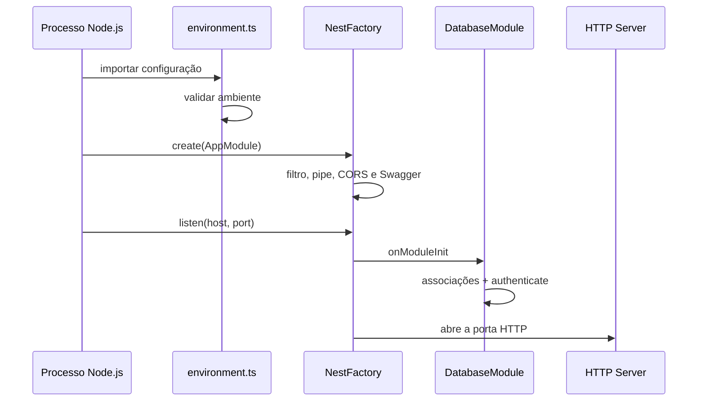

O bootstrap HTTP habilita CORS sem política restritiva explícita. Swagger é publicado em todos os ambientes.

O primeiro `SUPER_ADMIN` é criado por processo separado. Consulte [scripts/README.md](../../scripts/README.md).

## Execução com containers

O Dockerfile usa múltiplos estágios:

| Estágio | Uso |
| --- | --- |
| `dependencies` | instalação completa por `npm ci` |
| `build` | compila `dist/` |
| `operations` | migrations e bootstrap com ferramentas de desenvolvimento |
| `test` | migrations e testes de integração |
| `production` | runtime com dependências de produção e `dist/` |

O processo de produção roda como usuário `node`. O Compose define:

- `db`: PostgreSQL com volume persistente;
- `migrate`: job de execução única;
- `api`: serviço de longa duração;
- `bootstrap-admin`: job opcional no perfil `bootstrap`.

O healthcheck da API chama `/docs`. Ele confirma resposta HTTP do processo, mas não é uma verificação dedicada de liveness ou readiness.

## Estratégia de testes

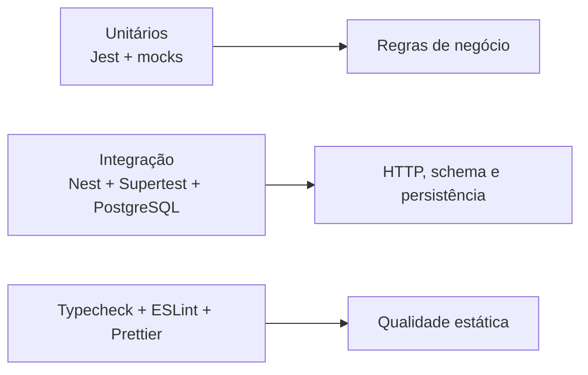

### Unitários

- executam em `test/unit`;
- instanciam casos de uso com mocks de ports;
- não inicializam NestJS ou banco;
- cobrem regras, autorização, guards e contratos de resposta.

### Integração

- executa `AppModule` real;
- usa os pipes e filtros globais;
- aplica migrations em PostgreSQL;
- chama HTTP por Supertest;
- valida schema, users e autenticação.

O tutorial executável está em [testing.md](../guides/testing.md).

## Segurança

### Controles implementados

- hashes bcrypt com custo 12;
- senha administrativa entre 8 caracteres e 72 bytes UTF-8;
- JWT com issuer, audience, expiração e algoritmo fixo;
- revalidação da credencial em cada requisição;
- troca obrigatória de senha temporária;
- erro genérico para login com e-mail desconhecido ou senha incorreta e erro específico para conta administrativa inativa;
- dummy hash para reduzir diferença temporal no login inválido;
- rejeição de campos extras nos DTOs;
- separação entre perfil e credencial;
- resposta de erro sem detalhes internos.

### Responsabilidades da infraestrutura externa

O repositório não implementa gateway ou reverse proxy. Em produção, a infraestrutura deve fornecer:

- TLS;
- rate limiting, principalmente no login;
- restrição de CORS e headers de segurança;
- armazenamento e rotação de segredos;
- coleta de logs e métricas;
- proteção contra abuso e limites de payload.

## Limitações conhecidas

| Limitação | Impacto |
| --- | --- |
| Participantes não autenticam | `userCode` identifica, mas não prova autoria |
| Sem liveness/readiness dedicados | healthcheck atual valida somente `/docs` |
| Sem logs estruturados ou request ID | troubleshooting e correlação são limitados |
| Sem métricas ou tracing | não há observabilidade nativa |
| CORS global sem restrição | origens devem ser controladas antes da produção |
| Sem rate limiting no processo | login depende de proteção externa |
| Swagger sempre habilitado | exposição deve ser avaliada em produção |
| Sem prefixo/versionamento HTTP | mudanças incompatíveis exigem coordenação |
| Controllers administrativos de Users não registrados | arquivos existentes não correspondem a endpoints ativos |
| Sem paginação nas listagens | volume crescente pode afetar memória e latência |
| Shutdown hooks não habilitados no bootstrap | sinais do sistema podem não acionar encerramento gracioso do Nest |

## Regras para evolução

### Nova feature

1. Defina invariantes e entidade no domínio.
2. Defina o port de repository.
3. Implemente o caso de uso contra o port.
4. Implemente adapter, mapper e model.
5. Crie migration para mudança de schema.
6. Exponha controller e DTO.
7. Registre providers e controllers no módulo.
8. Adicione testes unitários e de integração.
9. Atualize design, flow, API reference e collection.

### Nova dependência entre módulos

- importe o módulo provedor;
- exporte somente o port ou caso de uso necessário;
- evite importar repositories concretos entre features;
- verifique ciclos antes de usar `forwardRef`;
- registre a dependência em [dependencies.md](./dependencies.md).

### Mudança estrutural

- discuta antes em RFC;
- registre a decisão final em ADR;
- preserve compatibilidade ou documente migração e rollback;
- atualize os diagramas e contratos no mesmo pull request.

## Documentos relacionados

- [Designs por módulo](./README.md)
- [Dependências](./dependencies.md)
- [Modelo de dados](./data-model.md)
- [Flows](../flows/README.md)
- [Referência da API](../guides/api-reference.md)
- [Tutorial de testes](../guides/testing.md)
- [ADRs](../adr/README.md)
- [RFCs](../rfc/README.md)
