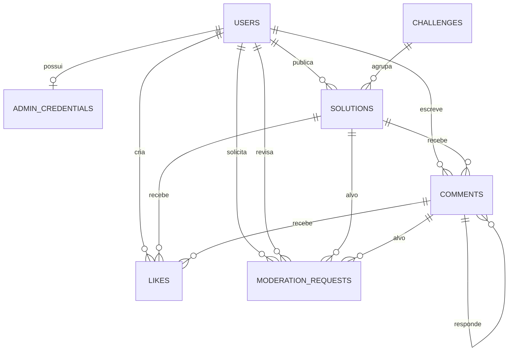

# Modelo de dados

O schema PostgreSQL é versionado pelas migrations em [`migrations/`](../../migrations). Este documento resume o modelo efetivamente criado por elas; os models Sequelize não substituem as migrations como fonte estrutural.

## Relacionamentos

## Tabelas

### `users`

Cadastro e autorização de todos os usuários.

| Campo | Tipo | Regra |
| --- | --- | --- |
| `id` | UUID | Chave primária |
| `userCode` | varchar(40) | Identificador público único |
| `name` | varchar(120) | Obrigatório |
| `email` | varchar(320) | Obrigatório e único |
| `jobPosition` | varchar(80) | Obrigatório |
| `enterprise` | varchar(120) | Obrigatório |
| `status` | enum | `ACTIVE`, `INACTIVE`, `BLOCKED`, `SUSPENDED` |
| `role` | enum | `PARTICIPANT`, `ADMIN`, `SUPER_ADMIN` |

O índice parcial `users_unique_super_admin` limita o sistema a um único `SUPER_ADMIN`.

### `admin_credentials`

Credencial separada do perfil de usuário. Existe no máximo uma por usuário.

| Campo | Tipo | Regra |
| --- | --- | --- |
| `id` | UUID | Chave primária |
| `user_id` | UUID | FK única para `users.id`, cascade no delete |
| `password_hash` | varchar(255) | Hash bcrypt; nunca armazena senha em texto |
| `must_change_password` | boolean | `true` para credencial temporária |
| `password_changed_at` | timestamp | Também funciona como versão da credencial no JWT |

### `challenges`

| Campo | Tipo | Regra |
| --- | --- | --- |
| `id` | UUID | Chave primária |
| `code` | varchar(60) | Único |
| `title` | varchar(120) | Obrigatório |
| `description` | text | Obrigatório |
| `status` | enum | `ACTIVE` ou `INACTIVE` |
| `displayOrder` | smallint | Positivo e único |

O índice `(status, displayOrder)` atende a listagem pública ordenada.

### `solutions`

| Campo | Tipo | Regra |
| --- | --- | --- |
| `id` | UUID | Chave primária |
| `userCode` | varchar(40) | FK para o autor em `users.userCode` |
| `challengeId` | UUID | FK para `challenges.id` |
| `title` | varchar(255) | Obrigatório |
| `description` | text | Obrigatório |
| `status` | enum | `PUBLISHED` ou `REMOVED` |
| `moderationReason` | varchar(500) | Preenchido na remoção |
| `moderatedByUserCode` | varchar(40) | FK para o moderador |
| `moderatedAt` | timestamp | Data da moderação |

As FKs de autor e desafio usam `RESTRICT` no delete. Há índices para `(challengeId, status, createdAt)` e `(userCode, createdAt)`.

### `comments`

| Campo | Tipo | Regra |
| --- | --- | --- |
| `id` | UUID | Chave primária |
| `solutionId` | UUID | FK para `solutions.id`, cascade no delete |
| `parentCommentId` | UUID, nulo | Autorrelacionamento; não pode apontar para si |
| `userCode` | varchar(40) | FK para `users.userCode` |
| `comment` | varchar(280) | Texto do comentário |
| `status` | enum | `ACTIVE`, `INACTIVE`, `EXCLUDED` |
| `moderationReason` | varchar(500) | Auditoria de moderação |
| `moderatedByUserCode` | varchar(40) | FK para o moderador |
| `moderatedAt` | timestamp | Data da moderação |

A coerência entre resposta e solução é validada no caso de uso. O banco impede autorreferência direta e usa `RESTRICT` para apagar um comentário que possui respostas.

### `likes`

| Campo | Tipo | Regra |
| --- | --- | --- |
| `id` | UUID | Chave primária |
| `userCode` | varchar(40) | FK para `users.userCode` |
| `type` | enum | `SOLUTION` ou `COMMENT` |
| `solutionId` | UUID, nulo | FK para solução |
| `commentId` | UUID, nulo | FK para comentário |

A constraint `likes_target_check` garante que exatamente uma das FKs corresponda ao `type`. Índices únicos em `(solutionId, userCode)` e `(commentId, userCode)` impedem like duplicado. Os alvos e usuários usam cascade no delete.

### `moderation_requests`

| Campo | Tipo | Regra |
| --- | --- | --- |
| `id` | UUID | Chave primária |
| `targetType` | enum | `SOLUTION` ou `COMMENT` |
| `solutionId` | UUID, nulo | FK para a solução alvo |
| `commentId` | UUID, nulo | FK para o comentário alvo |
| `status` | enum | `PENDING`, `APPROVED`, `REJECTED` |
| `reason` | varchar(500) | Motivo da solicitação |
| `requestedByUserCode` | varchar(40) | FK para o solicitante |
| `reviewedByUserCode` | varchar(40), nulo | FK para o revisor |
| `reviewReason` | varchar(500), nulo | Justificativa da revisão |
| `reviewedAt` | timestamp, nulo | Data da revisão |

Constraints garantem exatamente um tipo de alvo e consistência entre status e campos de revisão. Índices parciais permitem somente uma solicitação `PENDING` por solução ou comentário.

## Política de exclusão e visibilidade

A aplicação prefere mudança de status para conteúdo de negócio, preservando auditoria. Exclusões físicas de entidades raiz são restringidas quando perderiam histórico; entidades dependentes como likes podem usar cascade. Consultas públicas aplicam visibilidade no repository e não devem depender apenas do cliente para ocultar conteúdo.

## Evolução do schema

Para alterar o modelo:

1. crie uma migration nova; não edite migrations já aplicadas em ambientes compartilhados;
2. atualize model, mapper, entidade e repository correspondentes;
3. adicione teste de migration/persistência e teste da regra afetada;
4. valide `up` e `down` em banco descartável;
5. atualize este documento e a [referência da API](../guides/api-reference.md), se o contrato externo mudar.
