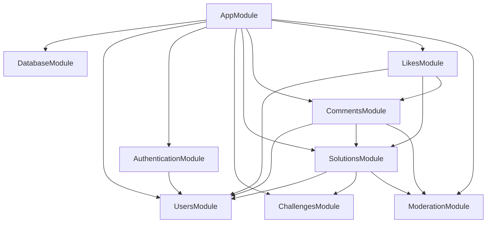
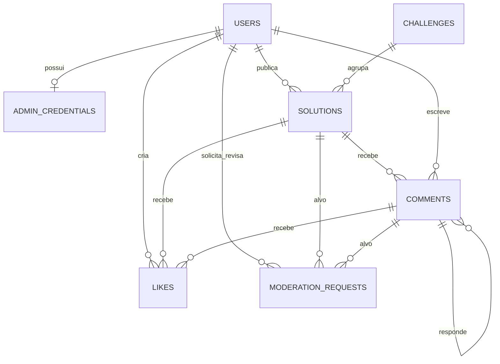

# Dependências entre módulos

## Composição NestJS

`AuthenticationModule` é global e exporta guards, JWT, serviço e repository de credenciais. `ModerationModule` exporta `DirectRemovalUseCase` para Solutions e Comments.

## Matriz

| Consumidor | Dependência | Motivo |
| --- | --- | --- |
| Authentication | Users | localizar identidade, papel e status |
| Solutions | Users | validar autor |
| Solutions | Challenges | validar desafio ativo |
| Solutions | Moderation | remoção direta auditada |
| Comments | Users | validar autor |
| Comments | Solutions | exigir solução publicada |
| Comments | Moderation | exclusão direta auditada |
| Likes | Users | validar ator ativo e papel |
| Likes | Solutions/Comments | validar alvo visível |
| Moderation | Models de Solutions/Comments | validar e alterar alvo em transação |

## Persistência

