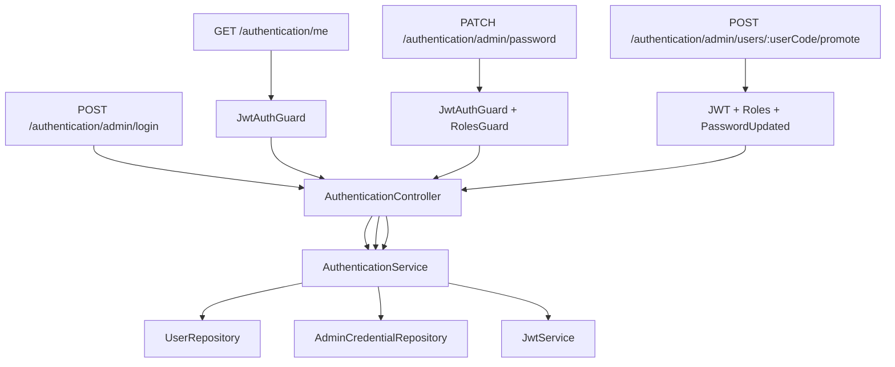

# AuthenticationModule

## Dependências

- importa `UsersModule`;
- registra `JwtModule` com HS256, issuer, audience e expiração;
- usa `AdminCredentialRepository`/`SequelizeAdminCredentialRepository`;
- exporta guards e serviços globalmente.

## Endpoints

| Endpoint | Entrada | Regra principal | Saída |
| --- | --- | --- | --- |
| Login | email e password | papel admin, status ativo e bcrypt válido | token + identidade |
| Me | Bearer token | token atual e usuário ainda elegível | userCode, role e flag de senha |
| Password | senha atual e nova | senha atual válida e nova diferente | novo token; antigo invalidado |
| Promote | userCode | somente SUPER_ADMIN; alvo PARTICIPANT | ADMIN + senha temporária |

## Persistência

`admin_credentials` possui uma credencial por `users.id`, hash bcrypt, flag de troca obrigatória e `passwordChangedAt`, usado como versão do token.
