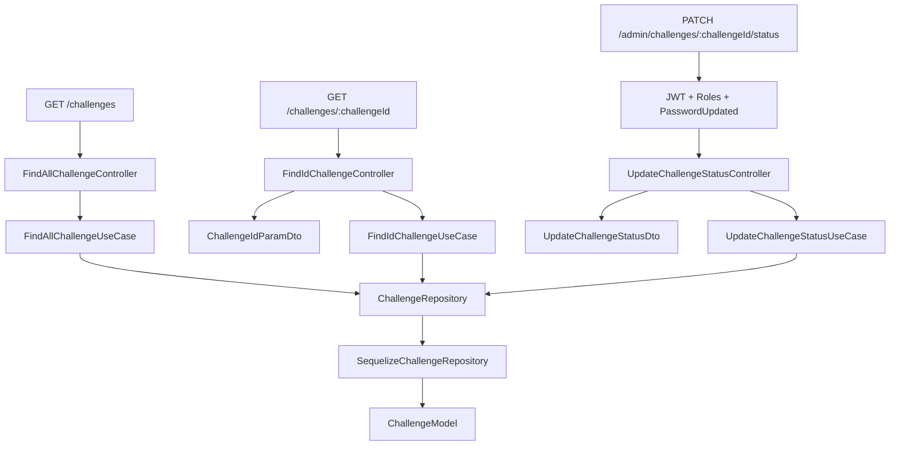

# ChallengesModule

## Dependências

Usa `ChallengeRepository` implementado por `SequelizeChallengeRepository` e exporta o port para Solutions.

## Endpoints

Consultas públicas retornam apenas `ACTIVE`. A alteração administrativa aceita `ACTIVE` ou `INACTIVE` e rejeita repetição do estado atual.
