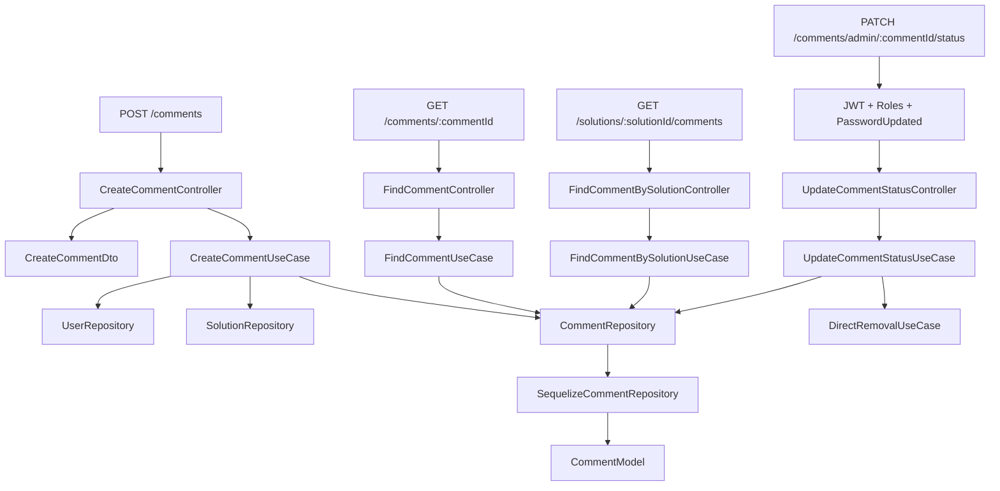

# CommentsModule

## Dependências

Importa Solutions, Users e Moderation. Exporta `CommentRepository` e casos de uso usados por outras features.

## Endpoints

## Regras

- Texto normalizado com 50 a 280 caracteres.
- Autor precisa existir e estar `ACTIVE`.
- Solução precisa estar publicada.
- Resposta exige pai da mesma solução.
- `SUPER_ADMIN` exclui diretamente com motivo; `ADMIN` usa solicitação de remoção.
