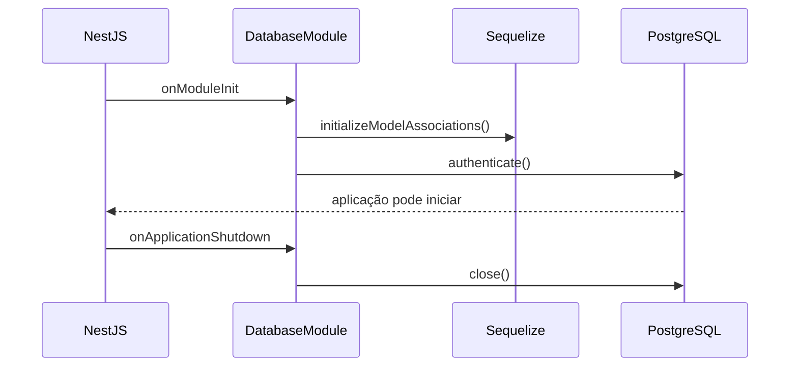

# DatabaseModule

## Papel

Autentica a instância Sequelize no bootstrap, inicializa associações uma vez e fecha a conexão no shutdown.

Não possui endpoints. As migrations são aplicadas fora do processo HTTP pelo Sequelize CLI.
