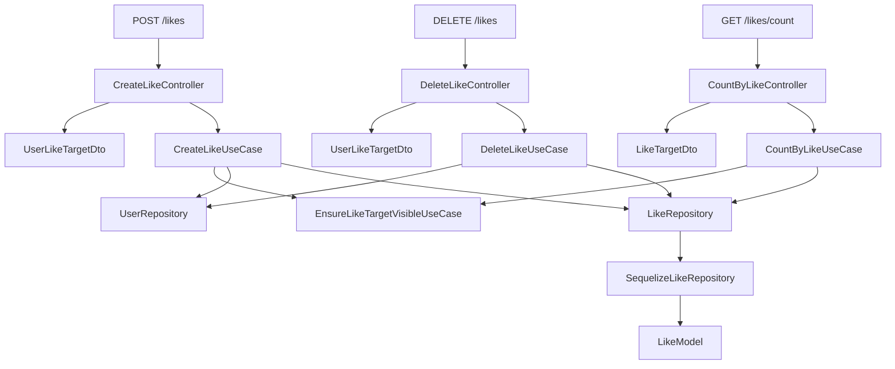

# LikesModule

## Dependências

Importa Users, Solutions e Comments para validar ator e visibilidade do alvo.

## Endpoints

## Regras

- Ator precisa ser `PARTICIPANT` ou `SUPER_ADMIN` e estar ativo.
- Criação e contagem exigem alvo visível.
- Índices únicos impedem like duplicado por usuário/alvo.
- Remoção é idempotente e não exige alvo ainda visível.
- `type` define exatamente uma FK: solution ou comment.
