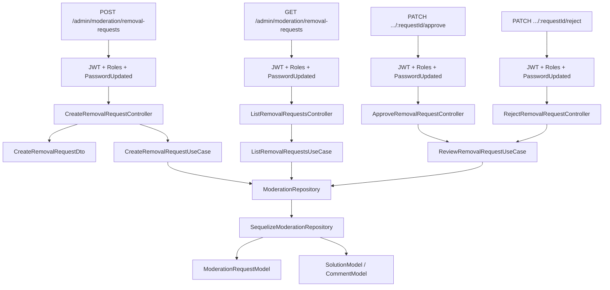

# ModerationModule

## Dependências

Usa `ModerationRepository`/`SequelizeModerationRepository` e exporta `DirectRemovalUseCase`. A autenticação vem do módulo global.

## Endpoints

## Regras

- Acesso: `ADMIN` ou `SUPER_ADMIN` com senha inicial alterada.
- Uma solicitação pendente por alvo. `ADMIN` e `SUPER_ADMIN` podem abrir pedidos.
- O solicitante não revisa o próprio pedido.
- Aprovação remove logicamente o alvo na mesma transação.
- Rejeição preserva o alvo.
- `DirectRemovalUseCase` cria auditoria já aprovada para remoção por `SUPER_ADMIN` quando não há pendência para o alvo.
