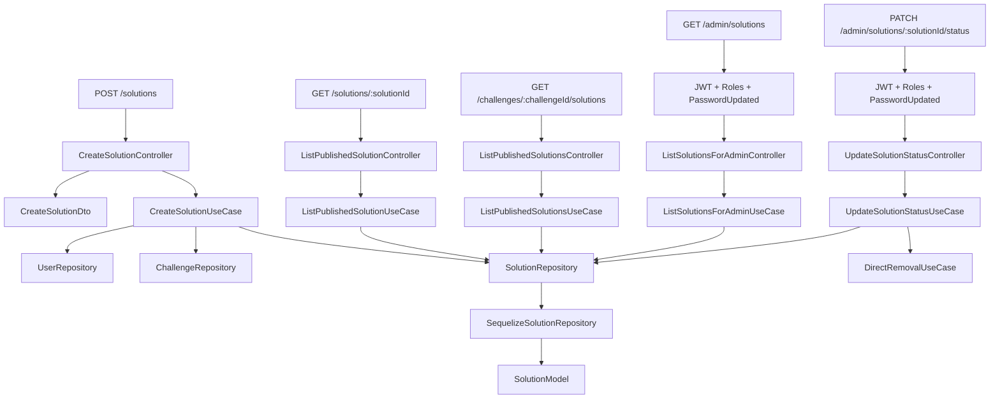

# SolutionsModule

## Dependências

Importa Users, Challenges e Moderation. Exporta `SolutionRepository` para Comments e Likes.

## Endpoints

## Regras

- Somente `PARTICIPANT` ou `SUPER_ADMIN` ativo publica.
- O challenge precisa estar ativo.
- Consultas públicas retornam somente `PUBLISHED` com autor elegível.
- `ADMIN` não remove diretamente; deve abrir solicitação.
- `SUPER_ADMIN` remove diretamente com motivo e registro de moderação `APPROVED`.
- `ADMIN` e `SUPER_ADMIN` podem republicar.
