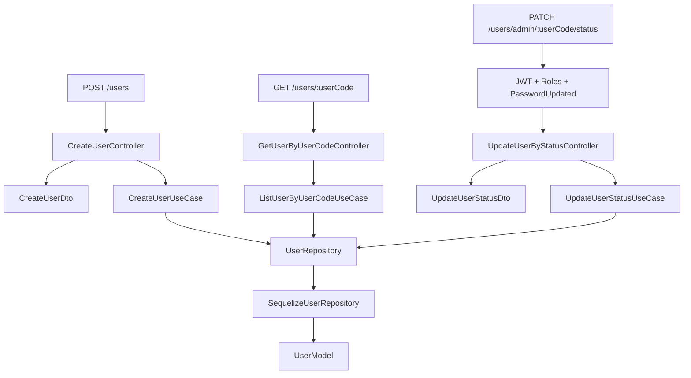

# UsersModule

## Dependências

Não importa outros módulos de negócio. Exporta `UserRepository` e `UpdateUserStatusUseCase`.

## Endpoints registrados

| Endpoint | Acesso | Regra principal |
| --- | --- | --- |
| `POST /users` | público | normaliza dados, impede e-mail duplicado e gera `userCode` |
| `GET /users/:userCode` | público | retorna somente perfil público |
| `PATCH /users/admin/:userCode/status` | ADMIN/SUPER_ADMIN | status deve pertencer a `UserStatus` |

## Limite importante

`ListUsersController`, `ListUserByIdController` e `ListUserByEmailController` existem em `src/users/application/controllers`, mas não estão no array `controllers` de `UsersModule`. Suas rotas não fazem parte da API ativa; as duas rotas dinâmicas também colidem entre si.
