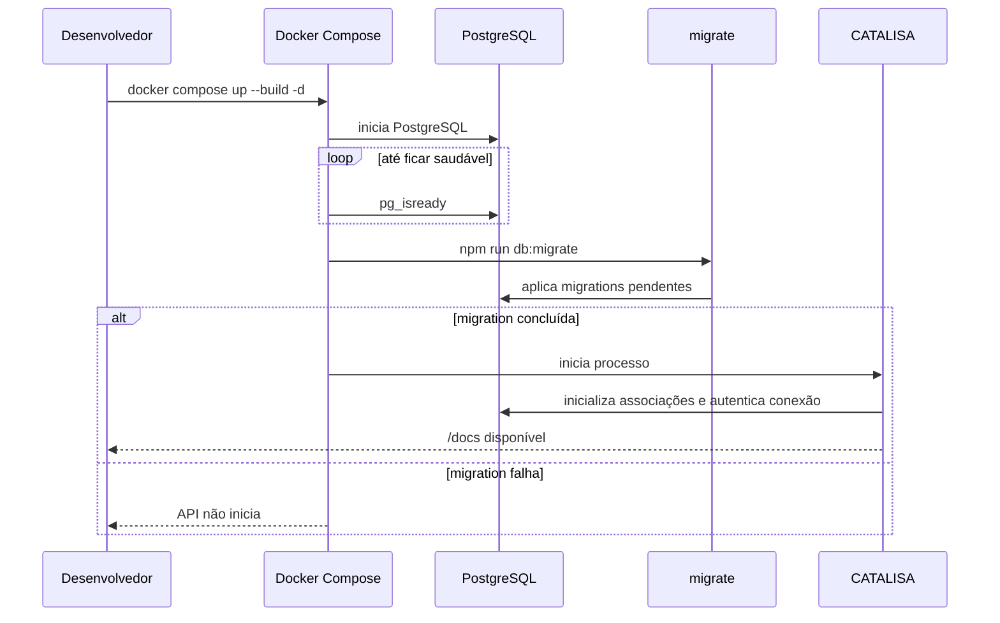
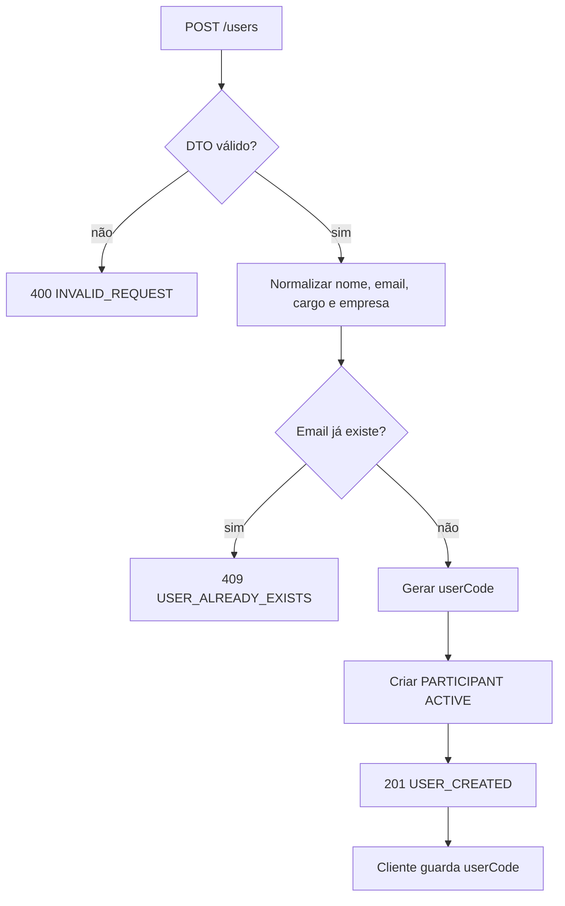
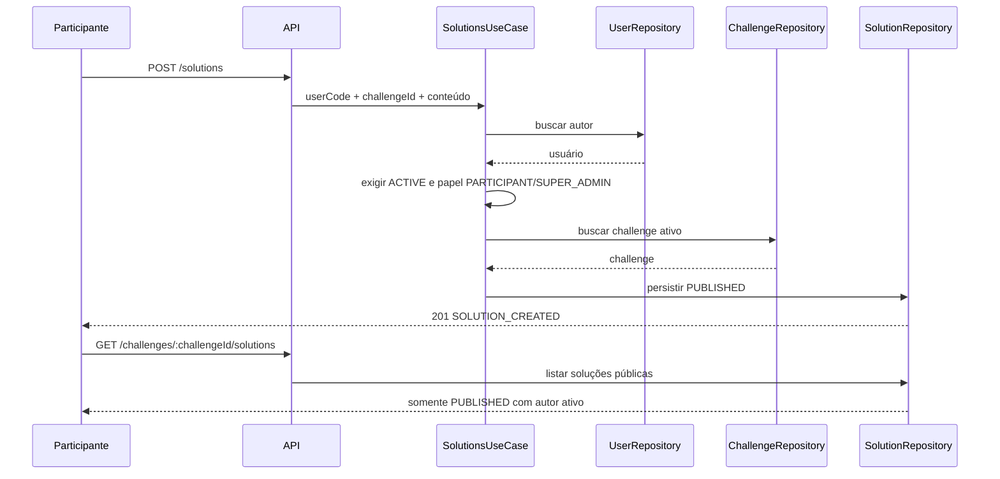
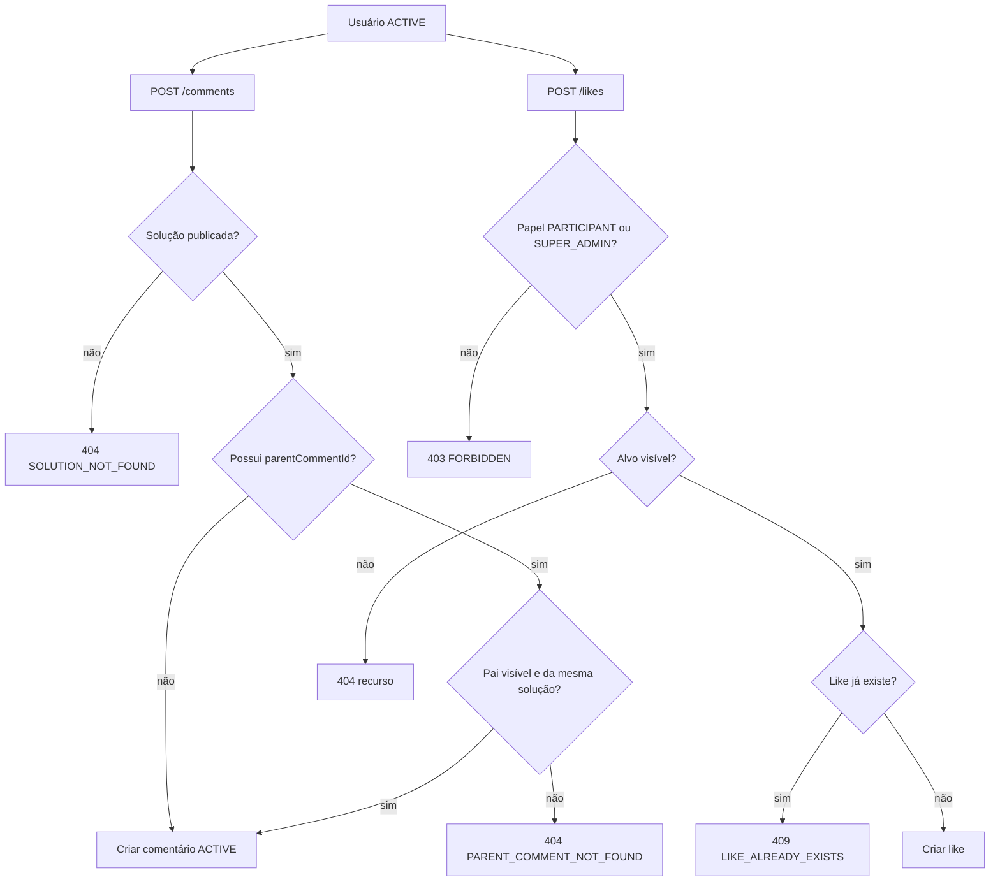
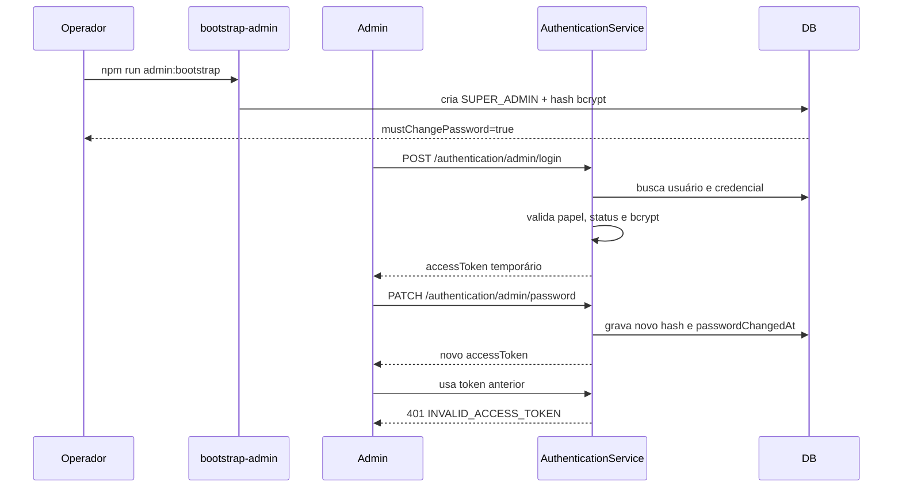
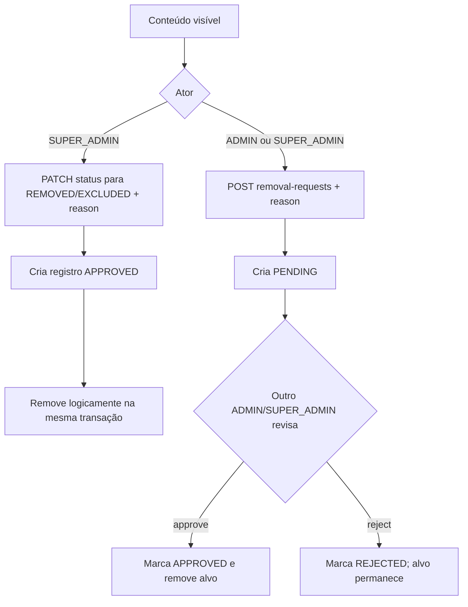

# Flows de negócio

Jornadas principais da CATALISA, do cliente até a persistência. Para payloads completos, consulte a [referência da API](../guides/api-reference.md).

## 1. Inicialização do ambiente

O schema vem das migrations. A API não usa sincronização automática para criar tabelas.

## 2. Entrada do participante

O `userCode` identifica o participante nos endpoints públicos, mas não é uma credencial criptográfica. Quem conhece o código pode tentar operar em nome do participante; essa limitação deve ser considerada no modelo de ameaças.

## 3. Publicação e descoberta de soluções

`ADMIN` não publica nem curte; `SUPER_ADMIN` pode participar desses fluxos. Soluções removidas permanecem no banco para auditoria, mas saem das consultas públicas.

## 4. Comentários, respostas e likes

A remoção do like é idempotente e continua permitida quando o alvo ficou oculto. A contagem inclui somente likes de usuários ativos em alvos visíveis.

## 5. Bootstrap, login e troca de senha

Enquanto `mustChangePassword=true`, o admin pode consultar a identidade e trocar a senha, mas `AdminPasswordUpdatedGuard` bloqueia as demais rotas administrativas.

## 6. Moderação

Existem dois caminhos de remoção:

Regras essenciais:

- `ADMIN` recebe `409 REMOVAL_REQUIRES_APPROVAL` se tentar remoção direta;
- o mesmo administrador não pode revisar a própria solicitação;
- existe no máximo uma solicitação `PENDING` por alvo;
- solicitações encerradas não podem ser revistas novamente;
- aprovação e mudança do alvo compartilham transação.

Administradores podem republicar soluções removidas e reativar comentários inativos. Comentários excluídos permanecem em `EXCLUDED`. O histórico da moderação é preservado.

## Matriz de autorização

| Ação | Sem JWT / `PARTICIPANT` | `ADMIN` | `SUPER_ADMIN` |
| --- | --- | --- | --- |
| Consultar conteúdo público | sim | sim | sim |
| Criar cadastro | sim | sim | sim |
| Publicar solução | `PARTICIPANT` ativo | não | sim, se ativo |
| Comentar | usuário ativo | sim, se ativo | sim, se ativo |
| Criar/remover like | `PARTICIPANT` ativo | não | sim, se ativo |
| Alterar status administrativo | não | sim, exceto remoção direta | sim |
| Criar/revisar solicitação | não | sim | sim |
| Promover participante para admin | não | não | sim |

As operações de participante recebem `userCode` no payload e não usam JWT. As operações administrativas exigem token, papel compatível e senha inicial já trocada.
