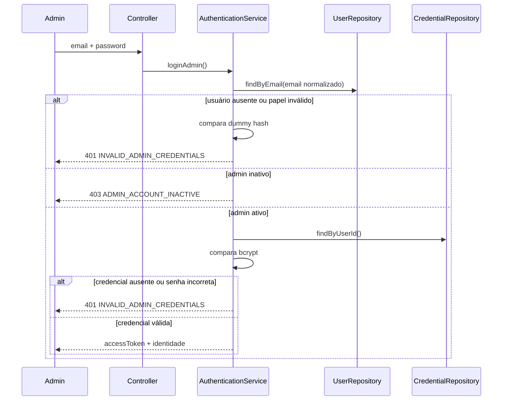
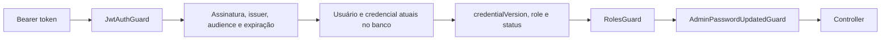
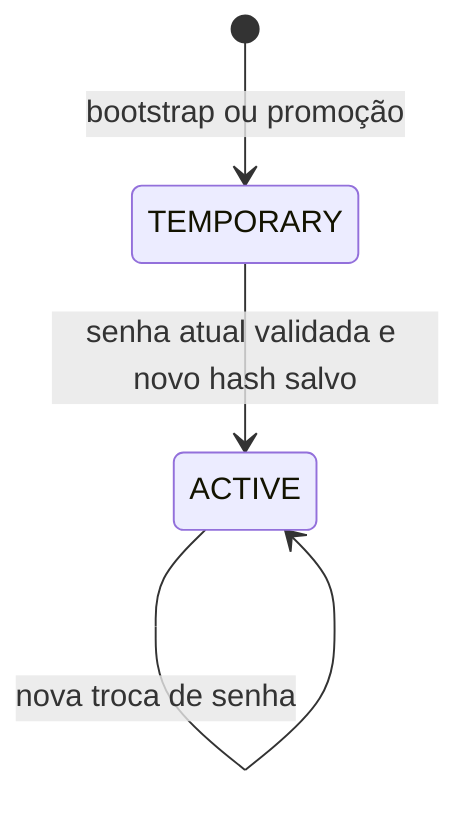

# Flow: AuthenticationModule

## Login administrativo

A comparação com hash fixo reduz diferença de tempo entre e-mail inexistente e senha incorreta. Credenciais inválidas retornam `401`. Uma conta administrativa inativa recebe `403`.

## Validação de uma rota protegida

Nem toda rota usa todos os guards. `GET /authentication/me` exige apenas JWT; a troca de senha exige JWT e papel; rotas administrativas comuns também exigem senha inicial alterada.

## Rotação de senha

Cada troca atualiza `passwordChangedAt`. Esse valor participa do token como `credentialVersion`, invalidando tokens emitidos antes da alteração.

## Promoção

Somente `SUPER_ADMIN` promove `PARTICIPANT`. A operação gera uma senha temporária aleatória, cria a credencial bcrypt e muda o papel para `ADMIN` de forma atômica. A senha temporária aparece somente na resposta da promoção.
