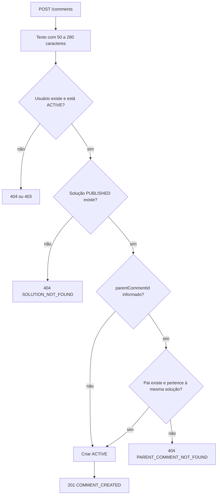
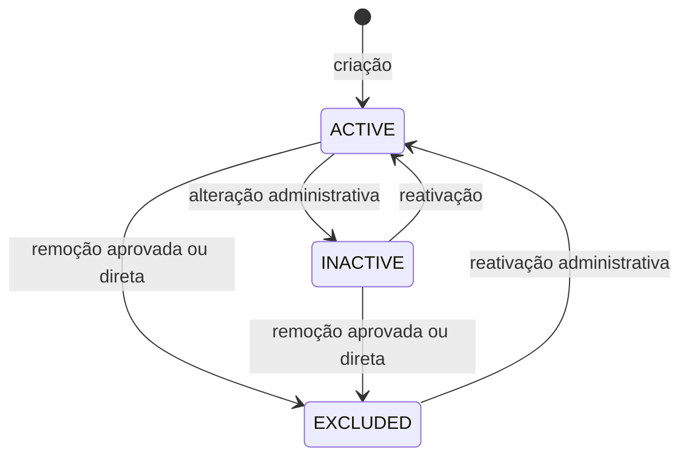

# Flow: CommentsModule

## Criar comentário ou resposta

O texto é validado novamente no caso de uso por quantidade de caracteres Unicode, além da validação do DTO.

## Visibilidade e status

Consultas públicas filtram o status do comentário, a visibilidade da solução e o estado do autor.

`SUPER_ADMIN` pode definir `EXCLUDED` diretamente com motivo. `ADMIN` deve usar o fluxo de solicitação de remoção; ambos podem alternar `ACTIVE` e `INACTIVE`.
