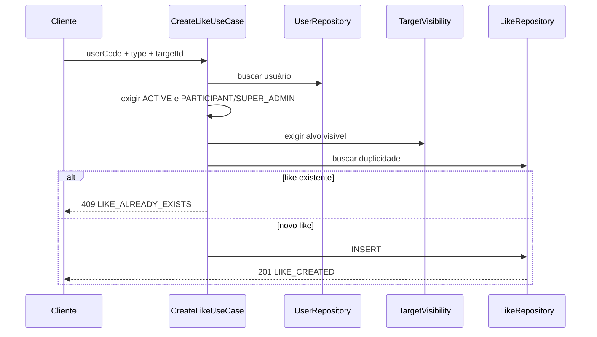

# Flow: LikesModule

## Criar

A consulta prévia melhora a mensagem, mas a garantia contra concorrência vem dos índices únicos no PostgreSQL.

## Remover

`DELETE /likes` valida usuário, papel e status, mas não exige que o alvo continue visível. O repository apaga se existir e a resposta é sempre `204`, tornando a operação idempotente.

## Contar

`GET /likes/count` exige alvo visível e conta somente likes de usuários ativos. O resultado usa `data: { count }` no envelope padrão.

## Identidade

As rotas de like não usam JWT. O `userCode` identifica o ator, mas não comprova sua identidade; consulte a observação de segurança nos [flows de negócio](../business-flows.md#2-entrada-do-participante).
