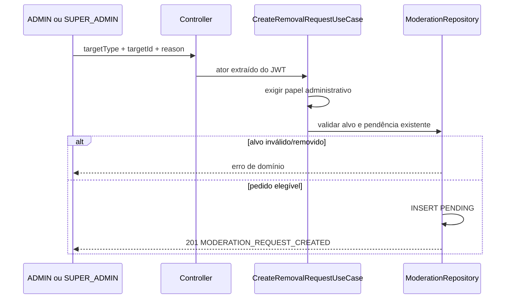
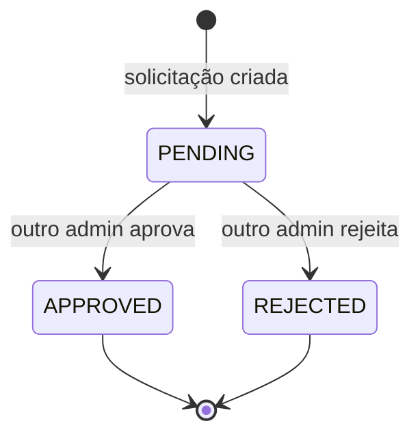

# Flow: ModerationModule

## Solicitação em duas etapas

## Revisão

Na aprovação, o repository bloqueia e atualiza a solicitação e o alvo na mesma transação. Na rejeição, somente a solicitação muda. O solicitante não pode revisar o próprio pedido.

## Remoção direta

Quando `SUPER_ADMIN` altera uma solução para `REMOVED` ou um comentário para `EXCLUDED`, `DirectRemovalUseCase` cria um registro já `APPROVED`, com o mesmo usuário como solicitante e revisor. Se já houver uma solicitação pendente para o alvo, a remoção direta retorna conflito.

## Garantias do banco

- exatamente uma FK de alvo conforme `targetType`;
- campos de revisão nulos em `PENDING` e preenchidos em estados finais;
- no máximo uma solicitação pendente por alvo;
- FKs de solicitante, revisor e alvo preservadas com `RESTRICT`.
