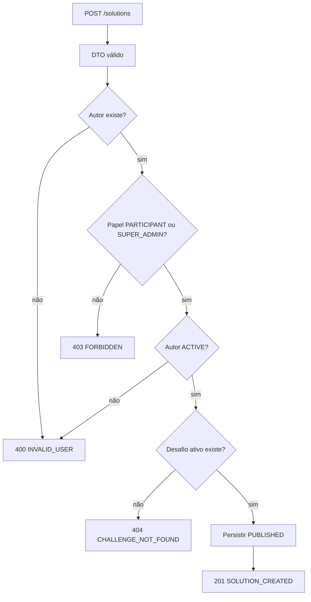
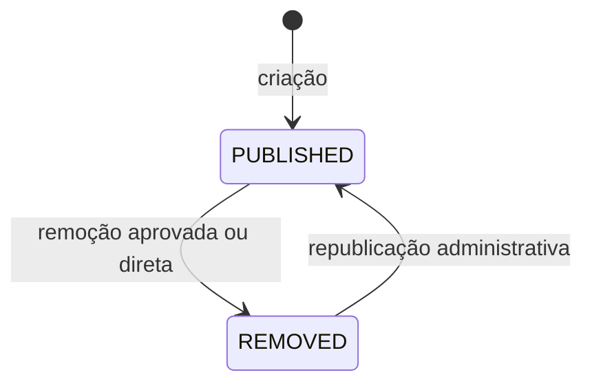

# Flow: SolutionsModule

## Criar solução

## Visibilidade

Consultas públicas retornam somente `PUBLISHED` com autor ativo. A listagem por desafio exige que ele exista, mesmo que esteja inativo. `GET /admin/solutions` inclui estados internos e auditoria de moderação.

## Alterar status

- `SUPER_ADMIN` pode remover diretamente, desde que informe motivo; o fluxo cria uma solicitação `APPROVED` e remove a solução na mesma transação.
- `ADMIN` não pode remover diretamente e recebe `REMOVAL_REQUIRES_APPROVAL`; deve abrir uma solicitação de moderação.
- `ADMIN` e `SUPER_ADMIN` podem republicar uma solução removida.
- Solicitar o status atual retorna `SOLUTION_STATUS_UNCHANGED`.
