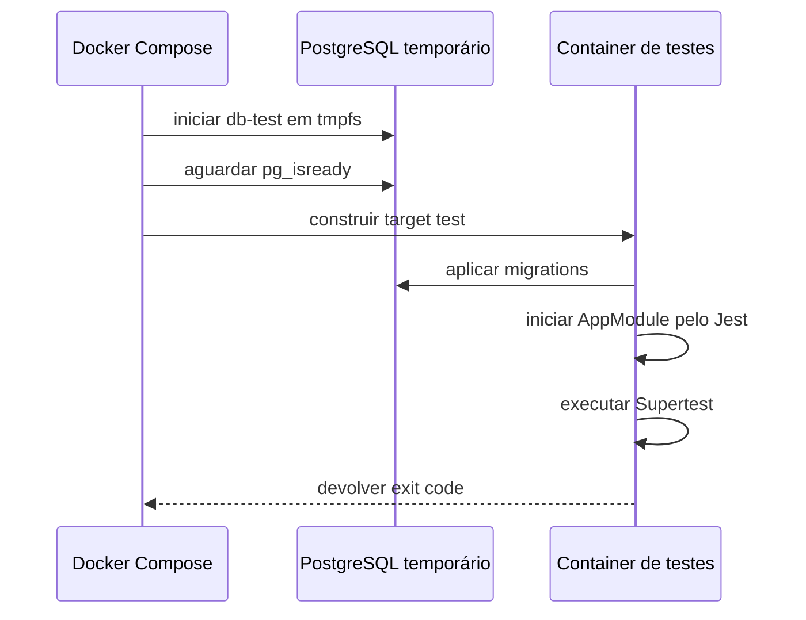

# Tutorial de testes

Este tutorial mostra como preparar e validar a CATALISA em diferentes níveis. Para apenas iniciar a aplicação, use o [setup local](./local-setup.md).

## O que é testado

| Nível | Infraestrutura | Valida |
| --- | --- | --- |
| Unitário | Nenhuma externa | regras dos casos de uso, guards, helpers, presenters e entidades |
| Integração | PostgreSQL real | migrations, NestJS, pipes, filtros, HTTP, repositories e transações |
| Smoke test manual | Aplicação completa | inicialização e jornada principal pela API |
| Qualidade estática | Nenhuma externa | tipos, lint e formatação |

## 1. Preparar o projeto

Na raiz do repositório:

```powershell
node --version
npm ci
```

A versão esperada do Node.js está em [`.nvmrc`](../../.nvmrc). Testes unitários usam variáveis seguras definidas em [`test/setup-env.ts`](../../test/setup-env.ts) e não precisam de `.env` nem PostgreSQL.

Para testes de integração, escolha um dos caminhos:

- Docker, recomendado e isolado;
- PostgreSQL local, útil para depuração interativa.

## 2. Executar os testes unitários

### Suíte completa

```powershell
npm test
```

O comando executa Jest em série (`--runInBand`) sobre `test/unit/`. Não abre conexão com o banco.

Resultado esperado atualmente:

```text
Test Suites: 5 passed
Tests:       66 passed
```

### Um arquivo

```powershell
npm test -- test/unit/solutions.spec.ts
```

Arquivos disponíveis:

| Arquivo | Escopo |
| --- | --- |
| `users-challenges.spec.ts` | Users e Challenges |
| `solutions.spec.ts` | Solutions e presenters |
| `comments-likes.spec.ts` | Comments e Likes |
| `moderation-common.spec.ts` | Moderation, HTTP comum e autorização |
| `authentication.spec.ts` | login, senha, guards, JWT e bootstrap |

### Um caso pelo nome

```powershell
npm test -- test/unit/authentication.spec.ts -t "invalidates"
```

Use um trecho do nome declarado em `it()` ou `test()`.

### Modo watch

```powershell
npm run test:watch
```

Esse modo é indicado durante implementação. Encerre com `Ctrl+C`.

## 3. Medir cobertura

```powershell
npm run test:cov
```

Relatórios gerados:

- resumo no terminal;
- HTML em `coverage/index.html`;
- LCOV em `coverage/lcov.info`.

Limites configurados em [`jest.config.cjs`](../../jest.config.cjs):

| Escopo | Statements | Branches | Functions | Lines |
| --- | ---: | ---: | ---: | ---: |
| Global | 70% | 70% | 70% | 70% |
| Use cases | 80% | 70% | 80% | 80% |
| AuthenticationService | 80% | 70% | 80% | 80% |
| Guards | 80% | 70% | 80% | 80% |

Cobertura é um gate, não uma medida suficiente de qualidade. Verifique também erros, transições de estado e efeitos no repository.

## 4. Integração isolada com Docker

Pré-requisito: Docker Desktop com engine Linux ativo.

```powershell
npm run test:integration:docker
```

O [`docker-compose.test.yml`](../../docker-compose.test.yml) executa esta sequência:



O banco usa `tmpfs`; seus dados não são persistidos. Depois da execução:

```powershell
npm run test:integration:docker:down
```

Esse comando remove containers, volumes e recursos órfãos do ambiente de teste.

### O que a integração atual cobre

O arquivo [`app.integration-spec.ts`](../../test/integration/app.integration-spec.ts):

1. monta o `AppModule` real;
2. registra o mesmo `ValidationPipe` e filtro HTTP da aplicação;
3. cria o super-admin inicial;
4. valida UUIDs e foreign keys das migrations;
5. cria e consulta usuário por HTTP;
6. valida normalização e duplicidade de e-mail;
7. testa login, troca de senha e invalidação do token antigo;
8. promove participante e autentica o novo admin;
9. fecha a aplicação e a conexão ao terminar.

## 5. Integração com PostgreSQL local

Use somente um banco descartável de testes. Nunca execute reset contra desenvolvimento ou produção.

Configure no ambiente de teste:

```dotenv
NODE_ENV=test
DB_HOST=localhost
DB_PORT=5432
DB_NAME=catalisa_test
DB_USERNAME=catalisa_test
DB_PASSWORD=senha-de-teste
JWT_SECRET=segredo-de-teste-com-pelo-menos-32-bytes
```

Preencha também `INITIAL_SUPER_ADMIN_*`, pois a suíte cria o administrador inicial.

Execute:

```powershell
npm run test:integration
```

Esse script desfaz todas as migrations do ambiente `test`, reaplica o schema e executa Jest com [`jest.integration.config.cjs`](../../jest.integration.config.cjs). O timeout por teste é 30 segundos.

> O reset é destrutivo para o banco apontado pelas variáveis de teste. Confirme `DB_NAME` antes de executar.

## 6. Smoke test da aplicação

Para validar manualmente uma instância completa:

```powershell
Copy-Item .env.example .env
# Preencha o .env
docker compose up --build -d
docker compose --profile bootstrap run --rm bootstrap-admin
docker compose ps
```

Depois:

1. acesse `http://localhost:3000/docs`;
2. faça login em `POST /authentication/admin/login`;
3. troque a senha em `PATCH /authentication/admin/password`;
4. use o novo token em `GET /authentication/me`;
5. crie um participante em `POST /users`;
6. consulte-o em `GET /users/:userCode`.

Para executar a jornada por Postman, importe a [collection da CATALISA](../collections/README.md).

Ao terminar:

```powershell
docker compose down
```

## 7. Criar um teste unitário

Use factories de [`test/unit/factories.ts`](../../test/unit/factories.ts) e mocks dos ports. Um teste unitário não deve importar `AppModule`, Sequelize nem abrir PostgreSQL.

Estrutura recomendada:

```ts
describe('NomeDoUseCase', () => {
  it('descreve a regra observável', async () => {
    const repository = {
      findById: jest.fn().mockResolvedValue(/* entidade */),
      update: jest.fn().mockResolvedValue(/* resultado */),
    };

    const useCase = new NomeDoUseCase(repository as never);

    const result = await useCase.execute(/* entrada */);

    expect(result).toEqual(/* contrato esperado */);
    expect(repository.update).toHaveBeenCalledWith(/* efeito esperado */);
  });
});
```

Cubra pelo menos:

- caminho de sucesso;
- recurso inexistente;
- papel ou status sem permissão;
- estado repetido ou transição inválida;
- falha do repository traduzida para `CatalisaCodes`.

## 8. Criar um teste de integração

Use `AppModule`, Supertest, migrations e PostgreSQL reais. Valide o comportamento pela fronteira HTTP:

```ts
const response = await request(app.getHttpServer())
  .post('/users')
  .send({
    name: 'Integration User',
    email: 'integration@example.com',
    jobPosition: 'Developer',
    enterprise: 'CATALISA',
  })
  .expect(201);

expect(response.body).toMatchObject({
  success: true,
  code: CatalisaCodes.USER_CREATED.code,
});
```

Regras para integração:

- cada teste prepara os próprios dados;
- não dependa da ordem de execução;
- valide status HTTP, envelope e efeito persistido;
- feche a aplicação em `afterAll`;
- não use mocks de repository.

## 9. Diagnosticar falhas

| Sintoma | Causa provável | Ação |
| --- | --- | --- |
| Unitário tenta conectar no banco | import de `AppModule` ou repository concreto | instancie o use case com mock do port |
| `JWT_SECRET` ausente | teste fora da configuração Jest | execute pelo script npm ou carregue `test/setup-env.ts` |
| Integração não inicia | Docker parado ou healthcheck falhou | confira `docker compose -f docker-compose.test.yml logs` |
| Migration falha | schema residual ou migration inconsistente | use o ambiente Docker ou banco local descartável |
| Teste passa isolado e falha na suíte | estado compartilhado | remova dependência de ordem e dados globais |
| Jest não encerra | aplicação/conexão aberta | garanta `await app.close()` em `afterAll` |
| Cobertura abaixo do limite | branch ou erro sem teste | abra `coverage/index.html` e cubra o caminho faltante |

Para logs completos da integração Docker:

```powershell
docker compose -f docker-compose.test.yml logs --no-color
```

## 10. Gate antes do pull request

```powershell
npm run typecheck
npm run lint
npm run format:check
npm run test:ci
npm run test:integration:docker
npm run test:integration:docker:down
```

Uma alteração está pronta quando os comandos aplicáveis passam, novas regras possuem testes e mudanças de contrato estão refletidas em designs, flows e collection.
