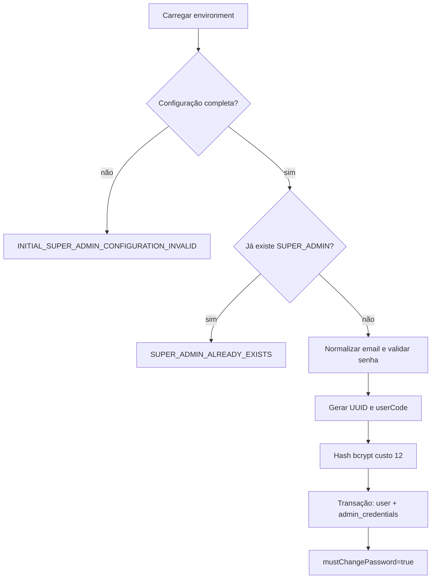

# Scripts operacionais

## Criar o primeiro SUPER_ADMIN

O primeiro `SUPER_ADMIN` é criado por [`bootstrap-initial-super-admin.ts`](./bootstrap-initial-super-admin.ts), não por endpoint público. A aplicação e o banco permitem somente um usuário com esse papel.

### Pré-requisitos

1. PostgreSQL acessível.
2. Migrations aplicadas.
3. Variáveis `INITIAL_SUPER_ADMIN_*` completas no `.env`.
4. `JWT_SECRET` válido, pois o script carrega a configuração da aplicação.

Variáveis necessárias:

```dotenv
INITIAL_SUPER_ADMIN_NAME=Nome do administrador
INITIAL_SUPER_ADMIN_EMAIL=admin@example.com
INITIAL_SUPER_ADMIN_JOB_POSITION=Administrator
INITIAL_SUPER_ADMIN_ENTERPRISE=CATALISA
INITIAL_SUPER_ADMIN_PASSWORD=senha-inicial-segura
```

A senha deve possuir pelo menos 8 caracteres e no máximo 72 bytes UTF-8.

### Executar com Docker

```powershell
docker compose up --build -d
docker compose --profile bootstrap run --rm bootstrap-admin
```

### Executar com Node.js no host

```powershell
npm run db:migrate
npm run admin:bootstrap
```

### O que o script faz



O script não imprime a senha. Em caso de sucesso, informa o `userCode`, o papel e se a troca de senha é obrigatória.

### Primeiro acesso

1. Faça login em `POST /authentication/admin/login`.
2. Use o token retornado em `PATCH /authentication/admin/password`.
3. Substitua o token antigo pelo novo.
4. Confirme em `GET /authentication/me` que `mustChangePassword=false`.

Enquanto a senha não for trocada, `AdminPasswordUpdatedGuard` bloqueia as rotas administrativas comuns.

### Falhas esperadas

| CatalisaCode | Situação |
| --- | --- |
| `INITIAL_SUPER_ADMIN_CONFIGURATION_INVALID` | alguma variável obrigatória está ausente |
| `SUPER_ADMIN_ALREADY_EXISTS` | o bootstrap já foi executado |
| `EMAIL_ALREADY_EXISTS` | o e-mail informado pertence a outro usuário |
| `INVALID_PASSWORD_LENGTH` | senha fora dos limites aceitos pelo bcrypt |

O comando deve ser executado uma única vez por ambiente. Não apague o super-admin para repetir o bootstrap em produção.

## Promover outros administradores

Depois do bootstrap, o `SUPER_ADMIN` promove um participante em:

```text
POST /authentication/admin/users/:userCode/promote
```

Essa operação não é um script. Ela gera uma senha temporária exibida somente na resposta, altera o papel para `ADMIN` e exige troca no primeiro acesso. A senha deve ser entregue por canal seguro.
